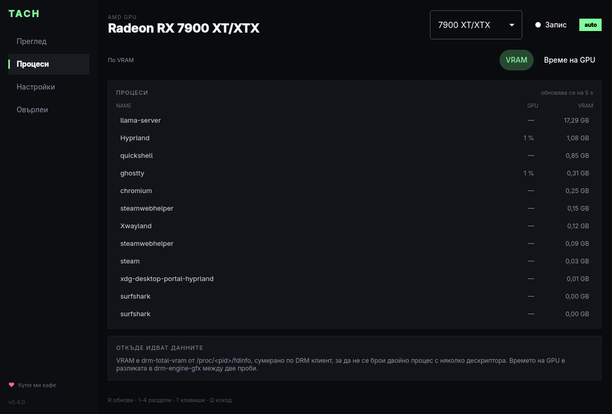
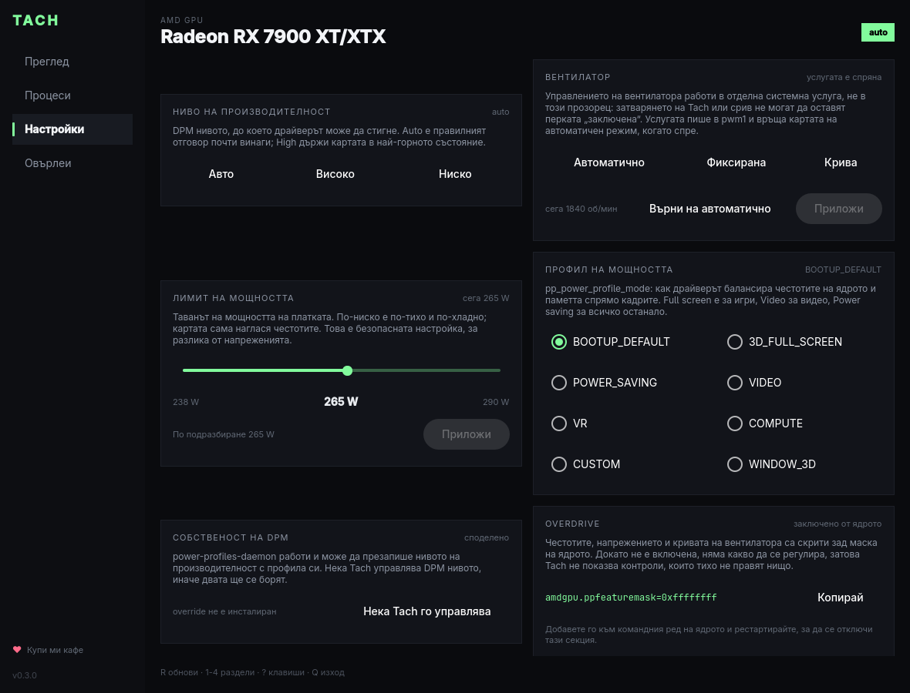

# Tach

An AMD GPU panel for Omarchy. Four tabs, one job: show what the card is doing,
how it got there, who is using it — and adjust the handful of things the kernel
actually lets you adjust.


Linux only. It reads `amdgpu` through sysfs — no daemon, no database, and no
root for anything you can only watch.

[](https://buymeacoffee.com/aurorauap)

## The tabs

**Overview** — a load ring, VRAM, junction / edge / memory temperatures, board
power and its limit, a minute of history on one chart, plus core clock, memory
clock, fan and PCIe link. Peaks for the last minute and since launch sit under
the chart, so a spike you missed is still there in numbers.

**Record** — the ● button in the header writes every sample to
`~/.local/state/tach/session-<timestamp>.csv` (timestamp, utilisation, VRAM,
three temperatures, power, fan, clocks). Stop it and the path lands in the status
line. `tach log --seconds 30 --csv bench.csv` does the same headless, or prints
JSON lines without `--csv` for scripts.

**Multiple cards** — if the machine has an APU and a discrete Radeon, the header
switches between them, and history resets with the card so the two never blend.

**Language** — the app follows Omarchy's language (Setup → Language), and the
`AUTO · BG · EN` chips at the bottom of the sidebar override it per-app when you
want to read it in the other language without changing the desktop. The choice
is remembered in `~/.config/tach/tach.conf`; `AUTO` hands it back to Omarchy.

 

**Processes** — every process holding VRAM, with its share of GPU time. Sort by
either. VRAM is `drm-total-vram` summed **per DRM client**, so a process with
several descriptors is not counted twice; GPU time is the change in
`drm-engine-gfx` between two samples, which is how you catch the one Chromium tab
that is actually rendering.

**Tuning** — three real controls, all through `pkexec`, so the password prompt is
the desktop's own polkit agent and Tach never holds a password:

**Presets** — Quiet, Balanced and Game each set the power limit, DPM level,
power profile *and* fan curve in one privileged step, so nothing is left half
applied. The active preset is matched from the live values, so the chip stays
honest if something else changes the card.

| Control | File | Why it is here |
|---|---|---|
| Performance level (auto/high/low) | `power_dpm_force_performance_level` | The simplest way to stop the card downclocking |
| Power limit (slider) | `hwmon/*/power1_cap` | Quiet and cool vs. fast, without touching voltages |
| Power profile | `pp_power_profile_mode` | 3D_FULL_SCREEN, VIDEO, POWER_SAVING, COMPUTE… |
| Fan: automatic, fixed speed, or a curve you drag | `hwmon/*/pwm1`, `pwm1_enable` | The difference between a 7900 XT and a hairdryer |

The fan curve is edited as a graph: drag any of the four points, and a dashed
line shows where the card is right now (*"80 °C → 60 %"*).

**Fan control runs in `tach-fan.service`, not in the window.** The GUI only writes
`/etc/tach/fan.json` and lets the service apply it, so closing Tach — or killing
it — cannot leave the fan pinned at its last value. The service restores
automatic control when it stops, `ExecStopPost` does the same if it dies, and
systemd restarts it on failure. Above 55 °C it never goes below 20 %, whatever
the curve says; below that, zero RPM is allowed.

If `power-profiles-daemon` is running it can overwrite the performance level, so
Tuning offers a one-click override (`--block-action=amdgpu_dpm`) and a way to
give it back.

**Profiles** — automatic switching. A small system service watches process
names and applies the matching preset: launch a game and the card goes to
3D_FULL_SCREEN with a fan curve that suits it, close it and the default comes
back. Rules match a case-insensitive piece of the process name (`steam_app_`
catches every Proton game), and the config lives in `/etc/tach/profiles.json`
so the service can read it without a password mid-game.

**Overlays** — MangoHud and vkBasalt presets, written into a block Tach owns
(inside `# >>> tach managed block >>>`), with the previous file backed up first.
Plus the exact launch-option strings for MangoHud, vkBasalt and FSR, one click to
copy.

## What is deliberately missing

**Overclocking.** Clocks and voltage live behind `pp_od_clk_voltage`, which this
kernel does not expose (`ppfeaturemask=0xfff7bfff`). Tuning shows an Overdrive
panel that says so and offers the kernel parameter to copy — rather than sliders
that do nothing. Writing a wrong clock/voltage pair can hang the card, so when it
is enabled it will get its own careful pass.

**A global FSR switch.** There is no such knob on Linux. Radeon Super Resolution
is `gamescope -F fsr` on the launch command, and FSR is otherwise a per-game
setting. The Overlays tab gives you the string; it does not pretend to toggle a
driver feature that does not exist.

**NVIDIA and Intel.** Different interfaces entirely. A settings screen that
silently does nothing would be worse than no app.

## Install

```sh
./bin/install          # qmake6 + make, then makepkg -fsi
```

Lands in the launcher (Super + Space) as **Tach**. Ships two services:
`tach-fan.service` (fan curve) and `tach-profiles.service` (automatic switching).
Needs `qt6-base`, `qt6-declarative`, `qt6-wayland` and `polkit` — all part of an
Omarchy install.

## Keys

| Key | Action |
|---|---|
| `1` – `5` | Overview, Processes, Tuning, Profiles, Overlays |
| `R` | Read a fresh sample |
| `?` | Key list |
| `Q` | Quit |

## Command line

```sh
tach status                 # human-readable snapshot
tach status --json          # for scripts and agents
tach set-level high         # DPM level
tach set-profile 1          # power profile index
tach set-power-cap 250      # watts, clamped to the driver's min/max
tach fan-apply '{"mode":"curve","curve":[{"temp":50,"percent":0},…]}'
tach preset quiet           # cap, level, profile and fan curve in one go
tach profiles-apply '{"auto":true,"default":"balanced","rules":[…]}'
tach fan-auto               # hand the fan back to the card
tach ppd-takeover           # keep power-profiles-daemon off the DPM level
```

The `set-*` verbs write root-owned sysfs files, so the GUI runs them as
`pkexec tach set-…`.

## How it stays honest

- One sample a second; the `/proc` walk runs every five, which keeps idle cost
  around **1-1.5% of one core**.
- Rule matching and preset application are tested against a fake `/proc` tree
  and a fake card, including the "N settings" count.
- The fan loop is tested against a fake hwmon tree (`tests/fan-service.sh`): it
  checks the curve, the zero-RPM point, the 20 % clamp on a hot card, and that
  `pwm1_enable` goes back to 2 when the service is asked to stop.
- The sysfs root is a constructor argument, so all 21 tests run against a fake
  card tree in a temp directory — no GPU, no root, no flakiness. Three bugs were
  caught this way, including `drm-engine-gfx` being `"1000 ns"` (the unit made
  every GPU-time column read zero).
- Anything the driver does not expose is described, not faked.

## Development

```sh
./bin/test                                              # 21 Qt Test cases
./build/tach --screenshot shot.png --delay 40000 --tab 0
./build/tach --screenshot small.png --size 466x508      # the tiled case
```

## Support

Tach is free software under the MIT licence, with no paid tier and no telemetry.
If it earns a place on your machine, you can buy me a coffee:

**[buymeacoffee.com/aurorauap](https://buymeacoffee.com/aurorauap)**

The same link is in the app, at the bottom of the sidebar.

## License

MIT. `src/theme.*` and `src/translator.*` are adapted from
[Omacut](https://github.com/omacom-io/omacut) (MIT, David Heinemeier Hansson);
their notice is kept in `LICENSE`.
