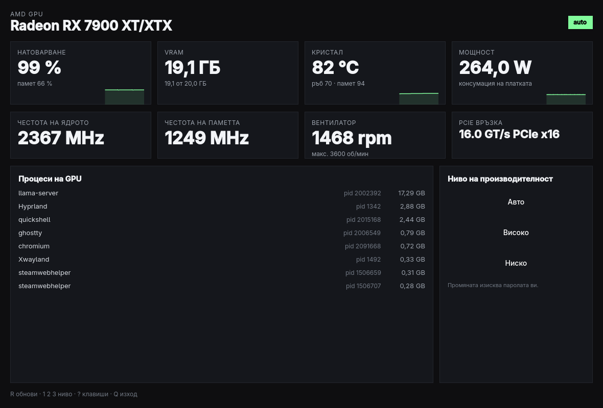

# Tach

An AMD GPU panel for Omarchy. One window, one job: show what the card is doing
right now, how it got there, and who is using it.



Linux only. It reads `amdgpu` through sysfs — no daemon, no root, no database.

## Why not `radeontop`

`radeontop` is a terminal app that shows card-wide counters and nothing else.
Tach keeps the same measurements, but:

- **shows who is using the memory** — per-process VRAM from `/proc/<pid>/fdinfo`,
  so "where did my 19 GB go" is answered by `llama-server`, not a mystery;
- **keeps a minute of history** so a spike is visible after it happened;
- **fits the desktop** — theme accent, window rounding, keyboard only, and a
  layout that reflows when Omarchy tiles it into a narrow column;
- **is readable in Bulgarian** and follows Setup → Language live, like the rest
  of Omarchy.

## What it shows

| Reading | Source |
|---|---|
| Utilisation and memory-controller busy | `gpu_busy_percent`, `mem_busy_percent` |
| VRAM used and total | `mem_info_vram_used`, `mem_info_vram_total` |
| Edge, junction and memory temperature | `hwmon/*/temp1..3_input` |
| Board power | `hwmon/*/power1_average` |
| Fan speed (and "off" in zero-RPM mode) | `hwmon/*/fan1_input`, `fan1_max` |
| Core and memory clock | the active state in `pp_dpm_sclk`, `pp_dpm_mclk` |
| PCIe link | `current_link_speed`, `current_link_width` |
| DPM performance level | `power_dpm_force_performance_level` |
| Per-process VRAM | `drm-total-vram` summed per `drm-client-id` in `/proc/*/fdinfo/*` |

The screenshot above is a real capture: 99% utilisation, 82 °C junction, 264 W,
1468 rpm, and `llama-server` holding 17.29 GB.

## Install

```sh
./bin/install          # builds with qmake6/make, then makepkg -fsi
```

It lands in the launcher (Super + Space) as **Tach**. Build only:

```sh
./bin/build && ./build/tach
```

Needs `qt6-base`, `qt6-declarative`, `qt6-wayland` and `polkit` (all part of an
Omarchy install).

## Keys

| Key | Action |
|---|---|
| `R` | Read a fresh sample |
| `1` `2` `3` | Performance level: auto, high, low |
| `?` | Show the key list |
| `Q` | Quit |

## Command line

```sh
tach status            # human-readable snapshot
tach status --json     # same, for scripts and agents
tach set-level high    # writes the DPM level; run under pkexec for root
```

The GUI calls `pkexec tach set-level …` when you pick a level, so the admin
password dialog comes from the desktop's own polkit agent — the app never asks
for or stores a password itself.

## What it deliberately does not do

Fan curves, voltage and clock overrides. This kernel does not expose
`gpu_od/fan_ctrl` for Navi 31, and guessing at `pp_od_clk_voltage` from a GUI is
how people end up with a bricked card. Tach shows the fan and the performance
level and leaves the rest to the kernel defaults.

It is also AMD-only on purpose: NVIDIA and Intel expose entirely different
interfaces, and pretending otherwise would mean a settings screen that silently
does nothing.

## Development

```sh
./bin/test                                   # 16 Qt Test cases, offscreen
./build/tach --screenshot shot.png --delay 40000
./build/tach --screenshot small.png --size 466x508   # the tiled case
```

The backend takes the sysfs root as a constructor argument, so tests build a
fake card tree in a temporary directory and drive `poll()` directly — no GPU
needed, no root.

## License

MIT. `src/theme.*` and `src/translator.*` are adapted from
[Omacut](https://github.com/omacom-io/omacut) (MIT, David Heinemeier Hansson);
their notice is kept in `LICENSE`.
